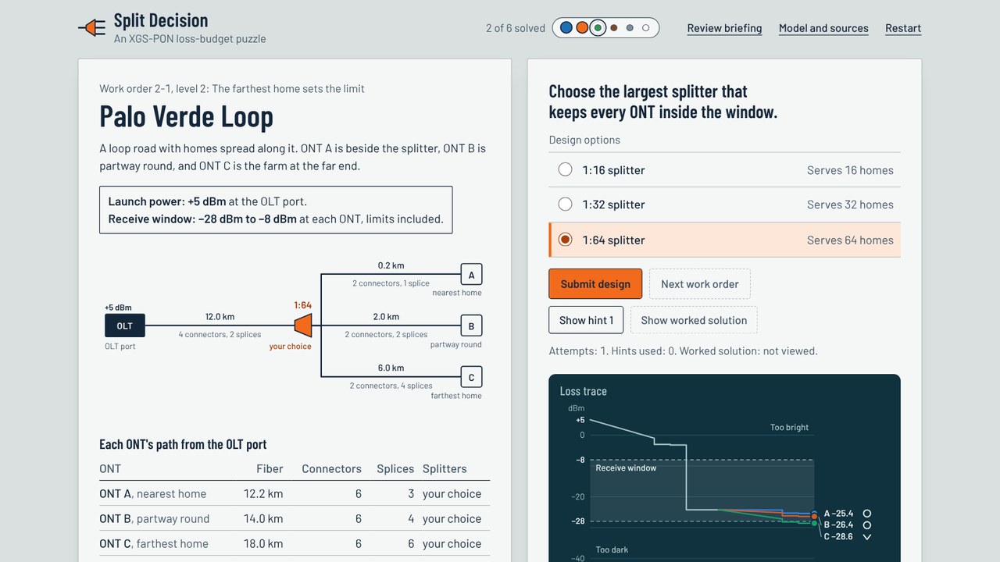

# Split Decision

**Pick the splitter that lights every home: not too dark, not too bright.**

Split Decision is a browser game for network engineers, sales engineers and students who know IP networking but have never designed the optical plant of a PON. You play the outside-plant designer for Saguaro Valley's new fiber network. Each work order shows a small PON, and you choose the splitter, or the attenuator, that gives every ONT a receive level inside its window: not too dark, not too bright. Each work order explains the result decibel by decibel, so you can use it on the next one.

A project from **NAF AC6 — Loop Engineering, Spec-Driven Development & the Future of VibeOps**.

| Project | Details |
| --- | --- |
| Status | Playable. Verified by automated checks in headless Chrome. Not yet played or timed by a person (see [Verification](#verification)) |
| Networking topic | Optical loss budgeting for a PON: path loss on the single fiber, launch power and the ONT's receive level, the receive window, splitters in one and two stages, attenuators |
| Typical session | 10 to 15 minutes is the target. It has not been timed with a person |
| Live demo | Not published yet |
| Built by | [OWNER: your name and GitHub handle], with Claude Code (model `claude-fable-5-2`) as the build agent |



## The challenge

Work order 1-1, Mesquite Lane: the farthest home is 18.0 km from the OLT port, behind 7 connectors and 7 splices. The OLT port launches the light at +5 dBm, and an ONT works only when it receives between −28 dBm and −8 dBm. You choose a 1:16, 1:32 or 1:64 splitter and submit.

The game then draws a loss trace, the light level falling from the launch power at each element of the path, and says where the ONT landed. With the 1:64 splitter the path loses 34.2 dB and the ONT receives −29.2 dBm: too dark, 1.2 dB below the dark limit. With the 1:16 it works at −22.2 dBm, but a larger splitter also fits. The 1:32 is the answer: 9.0 + 3.5 + 0.7 + 17.5 = 30.7 dB of loss, so +5 dBm − 30.7 dB = −25.7 dBm, and it serves the most homes.

## What you'll learn

| By the end, you can… | You'll practice by… |
| --- | --- |
| Calculate one ONT's optical path loss by adding fiber, connector, splice and splitter losses, take it from the launch power, and compare the receive level with the dark limit of the receive window | Choosing the largest splitter a single path can carry (level 1) |
| Apply the receive window to every ONT on a PON and compare competing designs, including two-stage splits | Choosing among one-stage and two-stage splitter designs for a PON with several ONTs (level 2) |
| Recognize an ONT that receives more than the bright limit and correct it with attenuation in the right place | Choosing an attenuator, and where it goes, for PONs with a very short path (level 3) |

**Before playing:** no knowledge of optics is needed. The first briefing teaches the basics, and each level's briefing has a worked example. You need to be able to add decimal numbers.

## Play locally

Download this repository or clone it using the URL from GitHub's **Code** button, then open a terminal in the project root.

```sh
python3 -m http.server 8000 --bind 127.0.0.1
```

On Windows with the Python launcher:

```powershell
py -m http.server 8000 --bind 127.0.0.1
```

Open **http://127.0.0.1:8000** in your browser. Keep the terminal running; **Ctrl+C** stops the server. If port 8000 is busy, use 8001 in both the command and the URL.

The game loads JavaScript modules and a JSON file over HTTP, so it has to be served. Opening `index.html` straight from a folder shows a message that says so. [Why modules need serving](https://developer.mozilla.org/en-US/docs/Web/JavaScript/Guide/Modules). There is nothing to install, and the game requests nothing from any other site.

## How to play

1. Read the level's briefing and its worked example, then choose **Start level**.
2. Read the work order: the plant drawing, the path table, the launch power, the receive window and the loss card.
3. Select one design and choose **Submit design**.
4. Read the result. The loss trace shows each ONT's light level falling along its path from the launch power. A wrong design tells you which ONT is outside the window, by how much, and a next step, and you can try again. The answer opens **Next**.
5. Use **Show hint 1**, **Show hint 2** and **Show worked solution** when you need help. Help is counted separately from solving.
6. Finish three levels, six work orders, to reach the session summary.

| Control | Action |
| --- | --- |
| Click or tap an option, then **Submit design** | Select a design and submit it |
| Tab, Shift+Tab | Move between controls. The focused control has a 3-pixel outline |
| Arrow keys, Space | Move between the design options and select one |
| Enter | Press the focused button. In the option group, Enter submits the selected design |
| **Show hint 1**, **Show hint 2**, **Show worked solution** | Reveal help in that order: the method, a worked step, then the answer with its full ledger. You still submit the answer yourself. Help closes once the work order is solved |
| **Review briefing**, **Model and sources** | Reopen the level's briefing during a work order; read the rule, what the game assumes and leaves out, and the eight sources |
| **Restart** | Asks first. **Keep playing** (or Escape) changes nothing; **Restart the game** clears the session |

**Progress:** each submitted design is one attempt, including a design that works but is not the largest. Submitting with nothing selected counts nothing. A work order is solved only by submitting its answer. Attempts, hints and worked solutions are counted separately and shown in the level and session summaries; there is no score or grade. Nothing is stored in the browser, so reloading the page starts a fresh session.

## What this game models

A PON runs on a single fiber, with both directions on the one strand. An ONT's optical path loss is the sum, in dB, of everything on that fiber between the OLT port and the ONT: fiber, connectors, fusion splices, splitters and attenuators. Its receive level, in dBm, is the launch power at the OLT port, +5 dBm, less that loss. Every ONT's receive level must land inside the receive window, limits included: −28 dBm, the dark limit, to −8 dBm, the bright limit. Among the designs that keep every ONT inside the window, the one that serves the most homes is the answer.

**The window and the launch power are the owner's.** −28 to −8 dBm at the ONT and +5 dBm at the OLT port are the levels the project owner has seen in deployed networks. They are not quoted from ITU-T G.9807.1. For comparison, the standard gives an XGS-PON OLT a launch power of +2 to +5 dBm in class N1 and +4 to +7 dBm in class N2, and an ONU a sensitivity of −28 dBm and an overload figure of −9 dBm, and it states the budget as classes of path loss: 14 to 29 dB for N1 and 16 to 31 dB for N2. With one launch power and no path penalty, the game's usable loss is 13 to 33 dB. The game says so in **Model and sources**, and lists the standard's figures beside its own. One point is open: the owner wrote a five with a hyphen in front, and the build agent read it as plus five, the value that lies inside the standard's ranges.

The loss card holds planning values, not measurements: fiber 0.5 dB/km, a connector 0.5 dB (one mated connection, where two fiber ends plug together in an adapter), a fusion splice 0.1 dB, 3.5 dB for each two-way split (so 1:32 is 17.5 dB), and attenuators at the value printed on them. All arithmetic is done in whole thousandths of a dB, and the content is rejected if any total is not exact to 0.1 dB, so rounding never decides an answer.

**Outside the model:** the game checks only the light the ONT receives, the downstream direction; a real design also checks the upstream direction. The loss card's fiber value is the one for the upstream wavelength, the higher of the two, so on a long route a real ONT would receive more light than the game works out: with the downstream value, the 1:64 option of work orders 1-1 and 2-1 would be inside the window. A real transmitter's power lies in a range, and a real budget takes its weakest and strongest values and allows for a path penalty; the game uses one launch power. A real budget keeps margin for repairs and ageing, and the game keeps none. Reflectance, bend loss and the differences between a splitter's ports are not modeled. The standard's loss classes and its maximum fiber distance are not used. The standard's limit on the difference between two paths on one PON is not graded, though a test confirms every answer in the game is within it. The game says so in its briefings and in **Model and sources**.

| Reference | What it supports |
| --- | --- |
| The project owner's field practice (no link: it is a decision, recorded as D13 and D14 in the specification) | The game's receive window, −28 dBm to −8 dBm at the ONT, and its launch power, +5 dBm at the OLT port |
| [ITU-T G.9807.1 (02/2023)](https://www.itu.int/rec/T-REC-G.9807.1-202302-I), Annex B, clause B.6.1, Table B.6.1 | The standard's loss classes, for comparison: N1 from 14 to 29 dB, N2 from 16 to 31 dB. Attenuators are required where a path would fall below the class minimum |
| ITU-T G.9807.1 (02/2023), Annex B, clauses B.9.2.6.1 and B.9.2.8.1; Tables B.9.2 to B.9.4 | The loss range includes splices, connectors, attenuators and other passive devices. Paths on one PON may differ by at most 15 dB. Downstream is 1575 to 1580 nm, upstream 1260 to 1280 nm |
| ITU-T G.9807.1 (02/2023), Annex B, clause B.9.2.6.2, Table B.9.3 | The standard's launch power for an XGS-PON OLT (+2 to +5 dBm in class N1, +4 to +7 dBm in N2) and its ONU receiver figures (sensitivity −28 dBm, overload −9 dBm, path penalty 1 dB), for comparison with the owner's values |
| [ITU-T G.652 (08/2024)](https://www.itu.int/epublications/publication/itu-t-g-652-2024-08-characteristics-of-a-single-mode-optical-fibre-and-cable), Appendix I, Table I.1; clause 8, Table 2, Note 2 | Typical link attenuation of 0.5 dB/km for 1260 to 1360 nm and 0.35 dB/km for 1565 to 1625 nm |
| [The FOA Reference Guide: what loss to expect](https://www.thefoa.org/tech/loss-est.htm), connector and splice paragraphs | A typical connector loses about 0.3 dB; TIA-568 allows up to 0.75 dB for one mated connection and 0.3 dB for a splice. The card's 0.5 and 0.1 dB sit inside those figures |
| [The FOA Reference Guide: using attenuators](https://www.thefoa.org/tech/ref/appln/attenuators.html), worked example | A receiver overloads when the cable plant loses less than a minimum; an attenuator adds the missing loss |
| [TEC GR/TX/OPT-001/01/APR-12](https://tec.gov.in/pdf/GRFA/TEC-GR-FA-OPT-001-01-APR-12.pdf), insertion loss table | One published set of maximum splitter losses (4.0, 7.1, 10.5, 13.8, 17.1 and 20.5 dB for 1×2 to 1×64). The game's 3.5 dB for each two-way split is within about half a dB of each |

ITU-T G.671, the usual reference for splitter loss, could not be read past its abstract during the build, so no number in the game is attributed to it.

## How it was built

The project follows the workshop's Spec Kit workflow: **constitution → specify → clarify → plan → tasks → analyze → implement**. The owner chose the topic and asked the build agent to make the design calls from the workshop's defaults, record each one, and present them with a playable game for review. Those decisions, and the owner's own (D11 to D14), are listed as D1 to D16 at the end of [the specification](specs/001-loss-budget-game/spec.md). The verification section below records which behaviors have actually been checked.

- **Stack:** HTML, CSS and JavaScript (native ES modules), inline SVG for the two drawings. No framework, no build step, no runtime dependency.
- **Build tools:** Claude Code 2.1.328 as a cloud session, model `claude-fable-5-2`; GitHub Spec Kit (specify CLI 1.4.3.dev0); Node 22 for the unit tests; Python 3.13 with Playwright 1.63 and Chrome for Testing 153 for the browser checks.
- **Runtime:** a current browser and any static web server. No account, backend, model or API key. No request leaves the game's own folder.
- **Planning inputs:** `StarterKit/CONSTITUTION.md`, `StarterKit/SPEC.md`, `StarterKit/PLAN.md`.
- **Working artifacts:** `.specify/memory/constitution.md`; in `specs/001-loss-budget-game/`: `spec.md` (with its clarifications), `checklists/requirements.md`, `plan.md`, `research.md`, `data-model.md`, `contracts/`, `quickstart.md`, `tasks.md`, `analysis.md`. The build agent's own record is `docs/build-log.md`.
- **What the owner's reviews changed:** the owner reviewed the game twice on the day it was built. First he set the window's limits at 8 and 28, in place of the standard's classes the first build used, and had "connector pair" changed to "connector", because a pair sounds like two fibers and a PON has one. The build agent applied 8 and 28 as path loss, as written, and recorded that they could also be receive levels. In his second review the owner said they are the ONT's receive levels, and gave the launch power. That changed the rule the game teaches: it now works out each ONT's receive level and shows dBm throughout. Each change went into the specification first. Every work order was re-worked by hand, the unit tests were seen to fail against the old game (52 of 158 the first time; the second time 50 of the 116 that could still load), and then the content and code were changed.
- **One useful design decision:** the first specification had the feedback for a design that works but is too small name the correct answer. Planning caught that this contradicts the constitution's rule that a wrong answer gives a next step, not the answer. The specification was changed: the feedback says a larger option also fits and does not name it. A unit test and a browser check now fail if any wrong design's feedback contains the answer.

Two more things worth knowing if you read the code:

- **Authored text carries no typed dB or dBm values.** Sentences in `data/levels.json` use tokens such as `{rx:A}` and `{dark}` that are filled from the loss card, the optics and the evaluator, and each briefing's worked example is a small plant the evaluator computes. If you change the loss card or the launch power, every sentence follows, and the validator reports any work order whose answer changed.
- **The answer key is independent of the code.** The six work orders were worked by hand in the specification before the evaluator existed. The unit tests compare the evaluator with that key, a second implementation in Python (`tools/oracle.py`, decimal arithmetic) recomputes it, and the browser checks compare what the page shows with it.

## Verification

**Last checked:** 2026-11-19, by the build agent, in headless Chrome for Testing 153.0.8010.12 on Linux, with Node 22.23.5 and Python 3.13.18. The full record, with every command, result and screenshot, is in [docs/verification.md](docs/verification.md).

To run the checks yourself, from the repository root:

```sh
node tests/run-node.mjs       # 173 unit tests; needs Node 20 or later
python3 tools/oracle.py       # recomputes the hand-worked answer key in Python
python3 tools/e2e.py          # 25 browser checks; needs: pip install playwright, and Chrome or Chromium
```

The unit tests also run in the browser: start the local server and open **http://127.0.0.1:8000/tests/**. One browser check, an audit with the axe-core accessibility engine, runs only when you give it the engine: `npm pack axe-core`, unpack it, and add `--axe path/to/axe.min.js`. Without that it is reported as not run.

| Check | Result | Evidence / notes |
| --- | --- | --- |
| Correct, incorrect, and boundary cases | Pass | All 20 options of the six work orders, the three worked examples and 4 boundary cases (−28.0 and −28.1 dBm, −8.0 and −7.9 dBm) match the hand-worked key: 173 of 173 unit tests; `tools/oracle.py` agrees on all 227 comparisons; the browser check `FULL` submits all 20 options in the page and compares each ONT's loss, receive level, state and wording |
| Unsupported content is not graded | Pass | Cases U1 to U6 are rejected by the validator (unit tests) and show a content error with no challenge in the page (browser check `CONTENT`) |
| Briefings and explanations checked against sources | Pass by the build agent; **reviewed in part by the owner** | Every stated value was traced to its source on 2026-11-19 (see the record). The owner reviewed the game twice and set the receive window and the launch power. One point is open: he wrote a five with a hyphen in front, which was read as +5 dBm. The loss card's planning values (0.5 dB/km, 0.5 dB a connector, 0.1 dB a splice, 3.5 dB a two-way split) are the build agent's choice and have not been confirmed by him |
| Retry, hint, duplicate Submit, completion, restart | Pass | Browser checks `AC3a`, `AC5`, `AC6`, `AC7`, `AC8`; unit tests of the session |
| Keyboard-only core playthrough | Pass by automation; **not run by a person** | Browser check `KEYBOARD`: from the first briefing to the summary with key presses only, at 1366 × 768, checking focus after every action |
| Accessible names, contrast, text size | Pass by automation | `NAMES`; `CONTRAST` (lowest 5.01 to 1); `TEXTSIZE` (running text at least 16 px); `AXE` (axe-core 4.14.1: no violation in 12 views). No screen reader was used |
| Narrow layout and reduced motion | Pass by automation | `NARROW` at 320, 390 and 768 px: no sideways page scroll, controls reachable; `MOTION`: no animation under reduced motion and the result present at once |
| No request outside the game | Pass | `ORIGIN`: every request of a full playthrough stays under the game's own path, fonts included |
| The checks can fail | Pass | 26 bugs were planted one at a time in the final build: 11 were caught by the unit tests and 15 by the browser checks, and each was reverted |
| Fresh checkout run instructions | Pass | Commit `493a690` was cloned into an empty folder on 2026-11-19. The three commands above passed there (159 unit tests, 172 oracle comparisons, 24 browser checks with the axe-core audit not run, and that audit passed when given the engine), and the game and `/tests/` were opened from `python3 -m http.server` as described under Play locally. Commits after it change documents only |
| A first-time player finishes in 10 to 15 minutes (SC-004) | **Not run** | Needs a person. Waiting for the owner |
| A teammate can say what each level taught (SC-008) | **Not run** | Needs a person. Waiting for the owner |
| Firefox, Safari, a real phone, a screen reader | **Not run** | Only headless Chrome was available to the build |
| Published demo | Not run | Not published |

## Known limitations and next steps

- **Known limitation:** no person has played the game yet. Everything above marked "by automation" was done by a script in one browser.
- **Known limitation:** the receive window and the launch power are planning values from the owner's field experience, not figures quoted from the standard, and the loss card's values are the build agent's choice inside published ranges. Use the limits of the optics you install.
- **Known limitation:** the model is deliberately small. See "Outside the model" above. In particular the game uses one launch power, the upstream fiber value for a downstream level, and no margin, so its answers are right for the game's loss card and are not a design rule.
- **Known limitation:** six fixed work orders. Once you know the answers there is nothing new to solve.
- **Known limitation:** the loss trace has three line colors that were checked for color-vision deficiency. A work order with more than three ONTs would draw the rest in the text color, told apart by their labels only.
- **Next improvement:** add a seventh work order that needs both ends of the window at once, a design where the nearest ONT needs an attenuator and the farthest needs a smaller split. It is data only: the engine already grades any round the validator accepts, and a unit test proves that with a trial round.

Found an incorrect answer or unclear explanation? Open an issue with the level and work order, the values shown, your choice, the expected result, the actual result, and a reference if you have one.

## Credits

Created by [OWNER: your name], with Claude Code (`claude-fable-5-2`) as the build agent. Workshop by John Capobianco, Joksan Flores, and Elliot Conner. Adapted from the [NAF AC6 workshop materials](https://github.com/automateyournetwork/NAF_AC6) and [Networking Video Game Starter Kit](https://github.com/automateyournetwork/NetworkingVideoGameStarterKit), using [GitHub Spec Kit](https://github.com/github/spec-kit).

**Assets and dependencies:** the code, the content, the drawings, the icon and the card image are original to this project; the card image and the README screenshot are captures of the running game. The typefaces are [Barlow and Barlow Condensed](https://github.com/jpt/barlow) by The Barlow Project Authors, included in `assets/fonts/` under the SIL Open Font License 1.1 (`assets/fonts/OFL-Barlow.txt`, `assets/fonts/OFL-Barlow-Condensed.txt`). The game has no other dependency.

**License:** Apache License 2.0. See [LICENSE](LICENSE). The font files keep their own license, named above.
